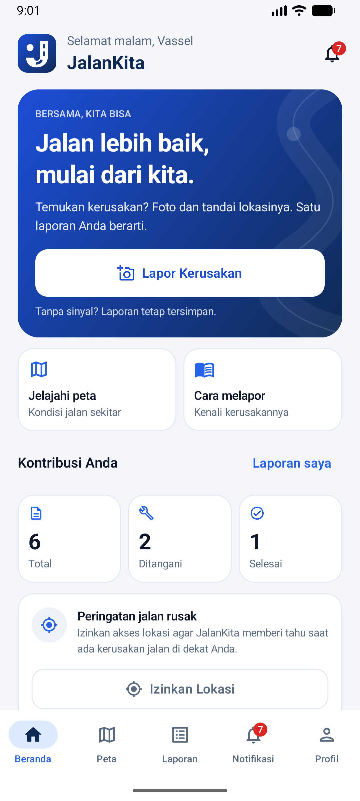
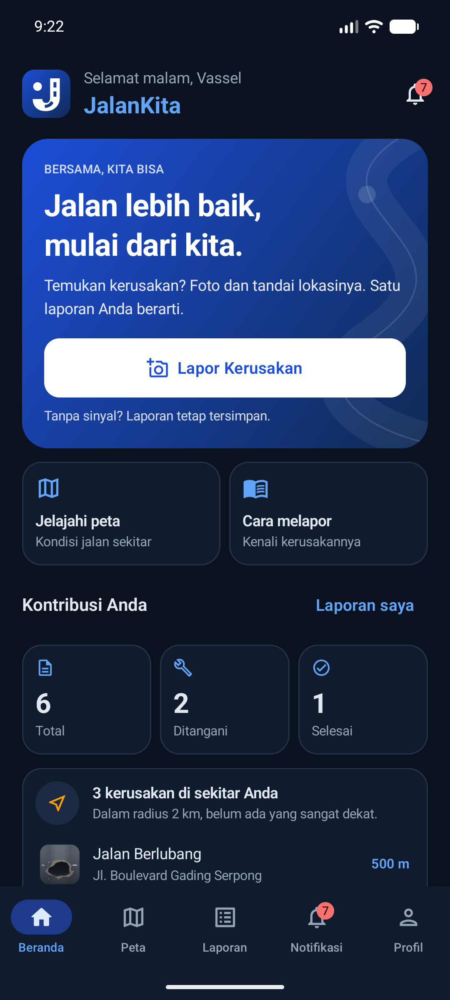
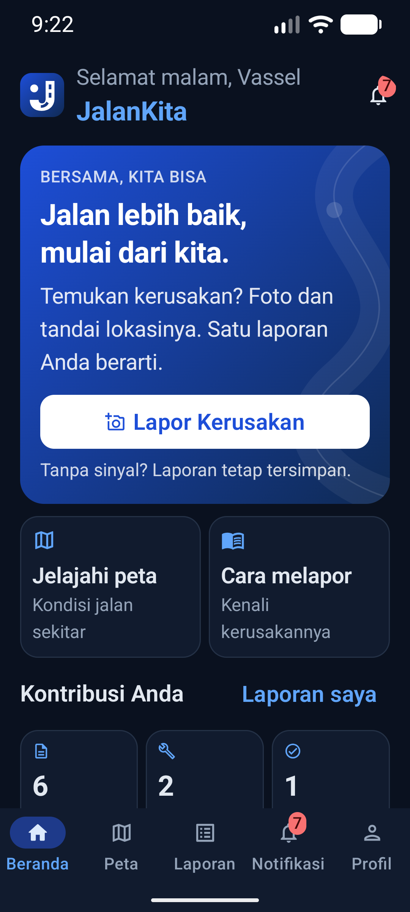
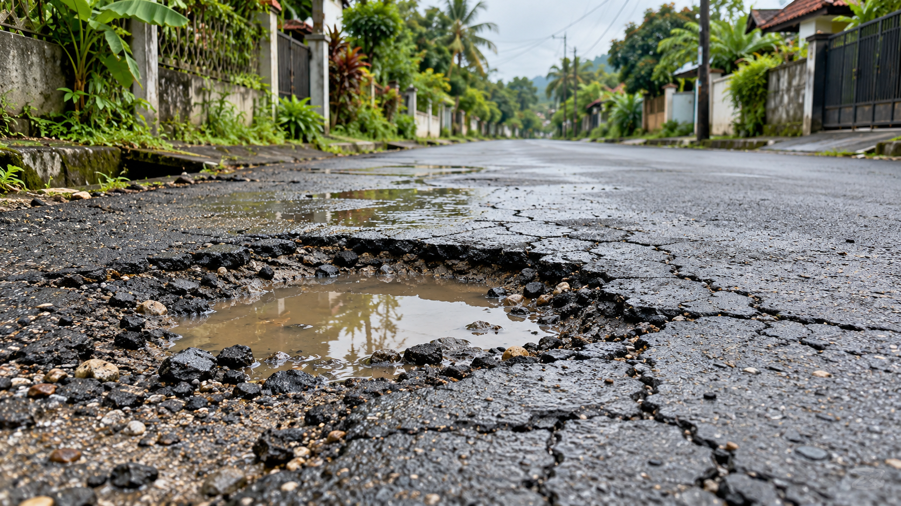

<p align="center">
  
</p>

<h1 align="center">Jalan lebih baik, mulai dari kita.</h1>

<p align="center">Foto kerusakannya. Tandai lokasinya. Pantau laporannya.</p>

**JalanKita** adalah aplikasi Android untuk melaporkan kerusakan jalan bersama warga. Ambil foto, pilih kategori kerusakan, dan sertakan lokasi. Laporan tersimpan di perangkat saat offline dan disinkronkan ketika koneksi tersedia.

## Tampilan aplikasi

| Tema terang | Tema gelap | Teks diperbesar |
|:---:|:---:|:---:|
|  |  |  |

Screenshot aplikasi dari pemeriksaan visual sebelumnya; lihat [catatan verifikasi](docs/VERIFICATION.md).

## Satu laporan, langkah menuju jalan lebih aman



*Ilustrasi kategori jalan berlubang. Foto pada laporan diambil langsung oleh pengguna.*

1. **Foto** — ambil gambar kerusakan yang terlihat jelas.
2. **Tandai** — pilih kategori dan lokasi, lalu tambahkan keterangan.
3. **Kirim & pantau** — simpan laporan, lihat status pengiriman dan tindak lanjutnya.

## Fitur utama

- **Tetap bisa melapor saat offline** — laporan dan foto tersimpan secara lokal.
- **Peta & peringatan sekitar** — temukan laporan kerusakan di dekat lokasi Anda.
- **Status yang jelas** — bedakan laporan menunggu sinkronisasi dengan laporan sedang ditangani.
- **Panduan visual** — kenali jalan berlubang, retak, genangan, dan kategori lainnya.
- **Rekam jejak pelapor** — lihat kontribusi dan laporan yang sudah ditinjau.
- **Tema terang & gelap** — tampilan mengikuti preferensi pengguna.

## Coba aplikasinya

Buka proyek di Android Studio dengan JDK 17 dan Android SDK yang sesuai konfigurasi proyek. Salin `local.properties.example` ke `local.properties`, lalu sesuaikan `sdk.dir`.

```bash
./gradlew assembleDebug
./gradlew installDebug  # perangkat atau emulator harus terhubung
```

Buat akun melalui **Daftar**, lalu masuk untuk membuat laporan. Pengiriman ke server menggunakan Supabase; ikuti [panduan konfigurasi](docs/SUPABASE.md). Jika server belum dikonfigurasi, akun dan laporan hanya tersimpan pada perangkat dan tidak ditandai terkirim.

Google Maps bersifat opsional. Tanpa API key, lokasi dapat dipilih dengan koordinat manual dan GPS tetap digunakan saat tersedia.

## Teknologi & dokumentasi

**Kotlin · Jetpack Compose · Material 3 · Room · WorkManager · Supabase · CameraX · Google Maps**

- [Panduan teknis, konfigurasi backend, dan alur penggunaan](docs/TECHNICAL.md)
- [Hasil pemeriksaan & batas pengujian](docs/VERIFICATION.md)
- [Logo dan identitas visual](docs/brand/README.md)
- [Skema Supabase](supabase/schema.sql)

```bash
./gradlew testDebugUnitTest
./gradlew lintDebug
./gradlew connectedDebugAndroidTest  # memerlukan perangkat atau emulator
```
